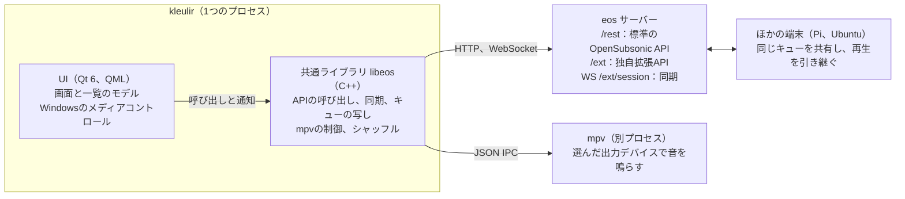

# kleulir クライアント要件定義

2026-11-27

kleulir（仮称）は、自作の拡張OpenSubsonicサーバー eos 向けのWindows用音楽再生クライアントで、C++とQt 6（QML）で作る。サーバー側の約束事は [要件定義](https://claude.ai/artifact/YSMz59jZw56DzgCaJiT9Rt) と [詳細設計](https://claude.ai/artifact/NzgE1GsRzzUFN6cHbja7ce) に従い、この文書はクライアントだけの要件を決める。

この文書の正本は Claude Docs の [kleulir クライアント要件定義](https://claude.ai/artifact/R2AQWZ9YgFucyJhSaMUk2k) で、このファイルはその写しである。

## 目的とスコープ

eosの独自機能（作品、楽曲とアレンジ違い、仮想フォルダ、リアルタイム同期）を、Windowsのデスクトップで不足なく使えるクライアントを作る。要件定義にあるUbuntu向けの最小限クライアントとPi向けのバックエンドとは別の、3つめのクライアントである。

**入れるもの**

- ライブラリの閲覧：アーティスト、アルバム、ジャンル、プレイリスト、お気に入り、評価。
- eos独自の閲覧：フォルダ、作品、アレンジ違い、演奏違い、関連曲。
- 再生：ギャップレス、ReplayGain、音量、出力デバイスの選択。
- 同期：キューの共有と、ほかの端末への再生の委譲。
- 編集：候補の承認と、楽曲、作品、関係などの手作業の登録（管理者だけ）。

**入れないもの**

- オフライン再生（曲のダウンロードとキャッシュ）、歌詞、イコライザー。
- ポッドキャスト、インターネットラジオ、動画。
- Windows以外のOS。

## 構成と技術

kleulirはUIと共通ライブラリを1つのプロセスに収め、サーバーとはHTTPとWebSocketで、mpvとはJSON IPCでつながる。サーバーをデータの正本とし、手元にはキャッシュと控えしか持たない。

UIはサーバーにもmpvにも直接は触れず、共通ライブラリを通す。ほかの端末とのやり取りは、すべてサーバーを経由する。

| 要素 | 技術 | 役割 |
| --- | --- | --- |
| UI | C++、Qt 6（QML） | 画面、一覧のモデル、設定 |
| 共通ライブラリ | C++（詳細設計の libeos を共有。Qtに依存しない） | `/rest` と `/ext` の呼び出し、同期、キューの写し、mpvの制御、シャッフル |
| 再生 | mpv（別プロセス、名前付きパイプのJSON IPC） | デコードと出力、ギャップレス、音量とゲイン |
| Windows連携 | System Media Transport Controls、資格情報マネージャー | メディアキーと「再生中」表示、秘密の保存 |

共通ライブラリは詳細設計の `libeos` をWindowsでもビルドして使う。同期やキューの規則を、PiやUbuntu向けのクライアントと1か所にまとめるためである。kleulirのリポジトリからは、eosのリポジトリ（github.com/elicxir/extended-opensubsonic-server）をgitのサブモジュールとして external/eos に置き、その中の client/libeos をCMakeで取り込む。2026-11-27時点のmain（M4まで）には client/libeos がまだないので、段階1の最初の作業はこのライブラリをeosのリポジトリに作ることになる。Windows向けに足すのは、mpvとのIPC（名前付きパイプ）と、設定と秘密の置き場所の2点。

## 接続先ごとの動き

kleulirは `GET /ext/info` が応答すればeosとして全機能を使い、応答しなければ標準のOpenSubsonic APIだけで閲覧と再生をする。使えない機能の画面と操作は出さない。

| 機能 | eos | 素のOpenSubsonicサーバー |
| --- | --- | --- |
| 認証 | 端末ごとのAPIキー（`/ext/auth/login` で取得） | トークン認証（`u`、`t`、`s`） |
| アーティスト、アルバム、ジャンル、プレイリスト | 使える | 使える |
| お気に入り、評価、再生回数の記録 | 使える | 使える |
| 再生、ジャケット | 使える | 使える |
| 検索 | 楽曲と作品でまとめた検索（`/ext/search`） | `search3` |
| フォルダ | 仮想フォルダの木（`/ext/folders`） | 出さない |
| 作品、アレンジ違い、関連曲、仮想アルバム | 使える | 出さない |
| キュー | リアルタイム同期（`WS /ext/session`） | 保存と復元だけ（`getPlayQueue`、`savePlayQueue`） |
| ほかの端末への再生の委譲 | 使える | 使えない |
| 編集と候補の承認 | 管理者だけ | 使えない |

- 判定は接続のたびに行う。`/ext/info` の `apiVersion` と機能の一覧、`getOpenSubsonicExtensions` の結果を持ち、画面はそれを見て出し分ける。
- eosの独自拡張APIや同期が未完成の間も、機能の一覧にないものを出さないという同じ仕組みで動かす。
- 編集の画面は、ログインしたユーザーが管理者のときだけ出す。

## 閲覧と検索

標準の画面はどのサーバーでも出し、eos独自の画面は `/ext` が使えるときだけ足す。曲の一覧からは、どの画面でも「次に再生」「キューの末尾に追加」「お気に入り」「評価」ができる。

| 画面 | 内容 | 使うAPI |
| --- | --- | --- |
| アーティスト | アルバムアーティストの索引と、そのアルバム | `getArtists`、`getArtist` |
| アルバム一覧 | 新着、よく聴く、最近聴いた、名前順、年、ジャンルで並べ替えと絞り込み | `getAlbumList2` |
| ジャンル | ジャンルの一覧と、そのアルバム | `getGenres` |
| プレイリスト | 一覧、作成、名前の変更、曲の追加と削除と並べ替え、削除 | `getPlaylists` ほか4つ |
| お気に入り | お気に入りにした曲、アルバム、アーティスト | `getStarred2` |
| アルバム（eos） | 曲を作品ごとにまとめて表示。物理アルバムと仮想アルバムを切り替えて一覧できる | `/ext/albums`、`/ext/albums/{id}/titles` |
| フォルダ（eos） | 仮想フォルダの木と、中のアルバム | `/ext/folders` |
| 作品（eos） | 作品の一覧と、アルバムをまたいだ曲 | `/ext/titles` |
| 曲の詳細（eos） | アレンジ違い、演奏違い、関連曲（関係の種類と向きつき）。そのままキューに足せる | `/ext/songs/{id}/versions` |
| 楽曲（eos） | 楽曲、作曲者、編曲ごとの曲。優先して再生するバージョンを選べる | `/ext/compositions/{id}` |
| 検索 | eosでは楽曲ごと、作品ごとにまとめた結果。素のサーバーでは曲、アルバム、アーティスト | `/ext/search`、`search3` |

- 推定の情報（規則やLLMが出したもの）には印を付け、確信度を見られるようにする。設定で推定を一覧と検索から除ける（`includeEstimated=false`）。
- ジャケットは `getCoverArt` を表示する大きさに合わせた `size` で取り、ディスクにキャッシュする。eosはIDに更新時刻が入るので、キャッシュの期限を気にしなくてよい。
- 数千曲の一覧でもスクロールが引っかからないよう、一覧は見えている行だけを描く。

## 再生と音量

音はmpvを別プロセスで起動して鳴らし、kleulirはJSON IPCで操作する。詳細設計の「クライアント共通ライブラリ」の決まりをそのまま使い、Windowsで違う点だけをここで決める。

**再生**

- 曲間を途切れさせない。mpvには「今の曲と次の曲」だけを渡し、曲が進むたびに次を足す。
- FLACは変換せずに受け取るのを既定にする。設定で形式とビットレートの上限を指定できる（回線が細いとき用）。
- サーバーにつながらず途中で止まったら、つながったときに同じ位置から再開する。
- シャッフルは、同じ楽曲のバージョンが重ならないようにする。楽曲ごとに優先するバージョンがあればそれを選ぶ。設定で普通のシャッフルに戻せる。
- リピート（なし、1曲、キュー全体）を持つ。
- 再生回数は `scrobble` で記録する。

**音量とReplayGain**

- ReplayGainはmpvに任せる。「トラック」「アルバム」「切」から選び、mpvの `replaygain` にそのまま渡す。
- 変換しない配信では、mpvがファイルのタグ（`REPLAYGAIN_*`、Opusの `R128_*`）を読む。kleulirは値を計算しない。詳細設計の「リアルタイム同期」のReplayGainと同じ決まりである。
- 変換した配信はタグを持たないので、曲情報の `replayGain` の値をmpvに渡す。形式とビットレートの上限の設定を作るときに合わせて作る。
- プリアンプ（dB）はmpvの `replaygain-preamp` に渡す。ピークによる音割れの防止はmpvの既定の動作（`replaygain-clip=no`）を使う。
- 値を持たない曲に使う既定のゲインは、mpvの `replaygain-fallback` で持てる（未実装）。
- mpvが見つからないときに使うWindowsのプレイヤーはタグを読めないので、曲情報のトラックのゲインを音量に掛けるだけにする。アルバムのゲインと増幅はできない。
- 音量はアプリの中で持ち、次の起動でも残る。ミュートを持つ。
- 出力デバイスを一覧から選べる。既定はWindowsの既定のデバイスで、選んだデバイスがなくなったら既定に戻る。

**Windowsとの連携**

- メディアキーと、音量のポップアップやロック画面の「再生中」表示に対応する（System Media Transport Controls）。曲名、アーティスト、アルバム、ジャケット、再生位置を渡す。
- リモコンとして動いているとき（ほかの端末が鳴らしているとき）も、メディアキーはその端末の操作として働く。
- mpvとのIPCは名前付きパイプを使う。配信のURLは認証情報を含むので、コマンドライン引数ではなくIPCで渡す。

## 同期と再生の委譲

eosにつないでいる間、kleulirはサーバーが持つユーザーごとのキューを1つ共有し、自分が鳴らす「再生端末」か、ほかの端末を操作する「リモコン」のどちらかとして動く。プロトコルは詳細設計の「リアルタイム同期」（`WS /ext/session`）に従う。

**キュー**

- キューの画面で、並べ替え（ドラッグ）、削除、次に再生への差し込み、全消去、プレイリストとして保存ができる。
- 操作は `queue.edit` で送り、画面はサーバーから届いた `state` で置き換える。手元で先に反映しても、届いた `state` が正とする。
- 項目は `entryId` で指す。同じ曲が2回入っていても取り違えない。

**再生の委譲**

- 端末の一覧（名前、接続中か、再生端末か）を常に見られる場所に置き、選んだ端末に再生を移せる（`transfer`）。
- 自分が再生端末でなくなったら音を止め、リモコンになる。再生、停止、シーク、曲送りは `control` で送る。
- リモコンの間は、再生端末が最後に報告した位置から自分の時計で進めて表示する。
- 再生端末の音量をリモコンから変えられる。
- 再生端末が切断中なら、そうと分かる表示にし、自分に引き取る操作を出す。

**切断と再接続**

- 切断中も、自分が再生端末なら手元のキューで再生を続ける。切断中であることは画面に出す。
- 1、2、4秒と間隔を広げ、最大30秒おきにつなぎ直す。つながったら `state` に合わせ、鳴らし続けていた位置を `progress` で送る。
- キューの控えを手元のファイルに持ち、サーバーにつながらないまま起動しても前回のキューを表示できる。

素のOpenSubsonicサーバーでは、キューは手元で持ち、`savePlayQueue` で保存して `getPlayQueue` で復元するだけにする。

## 編集と候補の承認

管理者としてeosにログインしているときだけ、推定の候補をさばく画面と、楽曲や作品を手作業で直す画面を出す。どれも `/ext` の書き込みをそのまま呼び、ファイルのタグは書き換えない。

**候補の承認**

- 候補の一覧を、状態（未処理、自動で取り込み済みなど）、規則、出どころ（規則かLLMか）、確信度で絞り込み、並べ替えられる。
- 候補ごとに、要約、対象の曲、承認したときに書かれる内容、根拠（LLMが挙げた理由と参照したページ）を見られる。対象の曲はその場で試聴できる。
- 承認、却下、内容を直してから承認ができる。複数を選んでまとめて承認、却下できる（`/ext/suggestions/batch`）。
- キーボードだけで次々にさばけるようにする。数千件を扱う前提である。

**手作業の編集**

| 対象 | できること |
| --- | --- |
| 楽曲と編曲 | 作成、名前や作曲者や編曲者の変更、削除、曲を編曲に紐付ける、紐付けをタグの値に戻す |
| 関係 | 曲どうし、楽曲どうしを種類（メドレー、引用、派生、カバー、関連）と向きを付けてつなぐ。メモを付ける |
| 作品 | 作成、名前や種類や年の変更、削除、曲を作品に入れる、外す |
| フォルダ | 手作業のフォルダの作成、名前や親や並び順の変更、削除、アルバムを入れる、外す |
| 仮想アルバム | 作成、変更、削除、曲の出し入れと曲順 |
| 曲とアルバム | 曲名や読みなどの上書き、上書きをやめてタグの値に戻す |

- タグから作られたものは消せない（サーバーが `tag_managed` を返す）。画面では消す操作を出さず、「この紐付けを外す」だけを出す。
- どの情報にも出どころ（手作業、タグ、規則、LLM）を表示する。
- 編集は、閲覧している画面（曲の詳細、アルバム、楽曲）からそのまま始められる。複数の曲を選んで、まとめて作品や編曲に紐付けられる。
- 手作業の情報の書き出しと読み込み（`/ext/export`、`/ext/import`）をメニューから呼べる。

一般ユーザーも使えるのは、楽曲ごとの優先バージョンの指定と、自分のAPIキーの一覧と無効化である。

## 非機能要件

機能は増やすが、「既存のクライアントは重い」という元の不満は繰り返さない。数値の目標は案であり、最初の段階が動いたところで測って決め直す。

| 項目 | 要件 |
| --- | --- |
| 対象 | Windows 11（64ビット） |
| 起動 | ウィンドウが出て操作できるまで1秒以内（案） |
| メモリ | 待機中200MB以内、mpvを除く（案） |
| 再生開始 | 曲を選んでから音が出るまで、変換しない配信で500ms以内（サーバーの目標と同じ） |
| 一覧 | 5000曲の一覧を引っかかりなくスクロールできる。通信はUIのスレッドを止めない |
| 規模 | 3000〜5000曲が前提。サーバーの上限である5万曲でも壊れない |

**秘密の扱い**

- APIキーは、設定ファイルに平文で置かず、Windowsの資格情報マネージャーに保存する。素のサーバーではパスワードの代わりに、トークン認証の `t` と `s` の組を同じ場所に保存する。
- ログに認証用の値（`apiKey`、`t`、`s`、`p`、`X-Api-Key`）を出さない。mpvのログも警告以上に絞る。
- ログインのときに入力したパスワードは、eosではAPIキーを受け取ったら、素のサーバーではトークンを作ったら捨てる。

**設定とデータの置き場所**

- 設定は `%APPDATA%\kleulir`、キャッシュ（ジャケット）とキューの控えは `%LOCALAPPDATA%\kleulir` に置く。
- ジャケットのキャッシュは上限を決め、超えたら古いものから消す。

**ライセンス**

- QtはLGPLで使う。動的リンクにし、LGPLで使えるモジュールだけを使う。配布するときはライセンスの表記を付ける。
- mpvは別プロセスとして呼び出す。同梱する場合は、mpvのライセンスに従ってソースの入手先を案内する。
- 配布する前に専門家に確認する（要件定義の方針と同じ）。

## 作る順番

サーバーはいま `/rest` まで動いているので、標準のAPIだけで成り立つところから作り、サーバーの進み具合に合わせて4段階で広げる。各段階の終わりで、日常的に使える状態にする。

1. **再生できる**：接続と認証、標準の閲覧と検索、再生、手元のキュー、ReplayGainと音量、出力デバイス、メディアキー。サーバーの前提は `/rest` だけで、Navidromeでも確かめられる。
2. **eos独自の閲覧**：フォルダ、作品、仮想アルバム、アレンジ違いと関連曲、まとめ検索、推定の印、楽曲を重ねないシャッフル。サーバーの前提は `/ext` の読み取り（M4）。
3. **編集と候補の承認**：管理者向けの画面。サーバーの前提は `/ext` の書き込み（M4）。
4. **同期と再生の委譲**：キューの共有、端末の切り替え、リモコン、再生端末の音量。サーバーの前提は `WS /ext/session`（M5）。

段階1のキューは、段階4でサーバーのキューの写しに置き換わる。最初から「キューを外から丸ごと置き換えられる」作りにしておく。

## 未決事項

決めごとが5件、サーバー側の実装に合わせて確かめることが3件残っている。

**決めごと**

- [ ] アプリ名を kleulir で確定するか。確定するならカタカナの読みを1つ決める
- [ ] 共通ライブラリ `libeos` が使うlibcurl（8.11以上）などの依存を、Windowsでどう用意するか（vcpkgなど）。ライブラリ自体はサブモジュールで共有すると決定済み
- [ ] mpvを同梱するか、利用者が入れたものを使うか
- [ ] 接続先を複数登録して切り替えられるようにするか（移行中はeosとNavidromeが並行して動く）
- [ ] 起動時間とメモリの目標値（非機能要件の案）を確定する

**サーバー側の確認事項**

サーバーに実装済みとされる3点。2026-11-27時点でGitHubのmainにも詳細設計にもまだ見当たらない。クライアントを書く前に、実際の形を詳細設計に反映してから合わせる。

- [ ] ReplayGain：曲の情報のどの項目に、どの値（トラックとアルバムのゲイン、ピーク）が載るか
- [ ] 再生端末の音量：同期のどのメッセージで送り、どのメッセージで現在の値が配られるか。値の範囲
- [ ] 再生回数の記録：同期中も再生端末が `scrobble` を呼ぶのか、サーバーが `progress` から数えるのか
